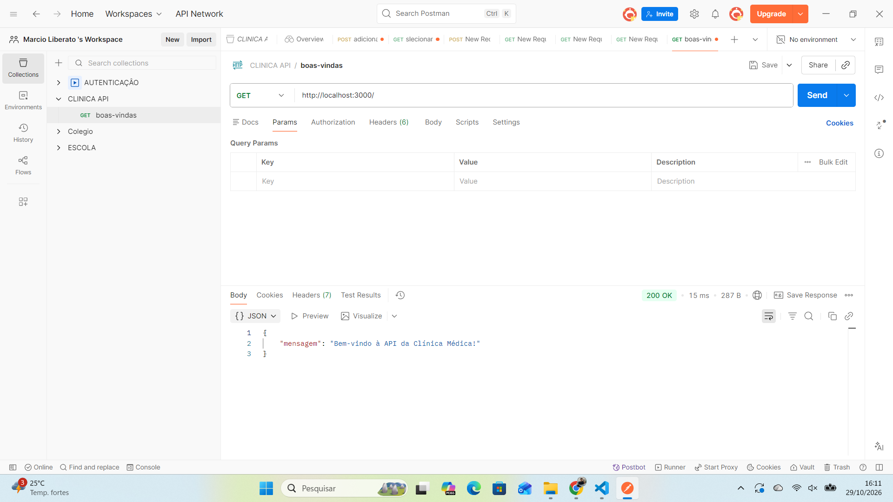
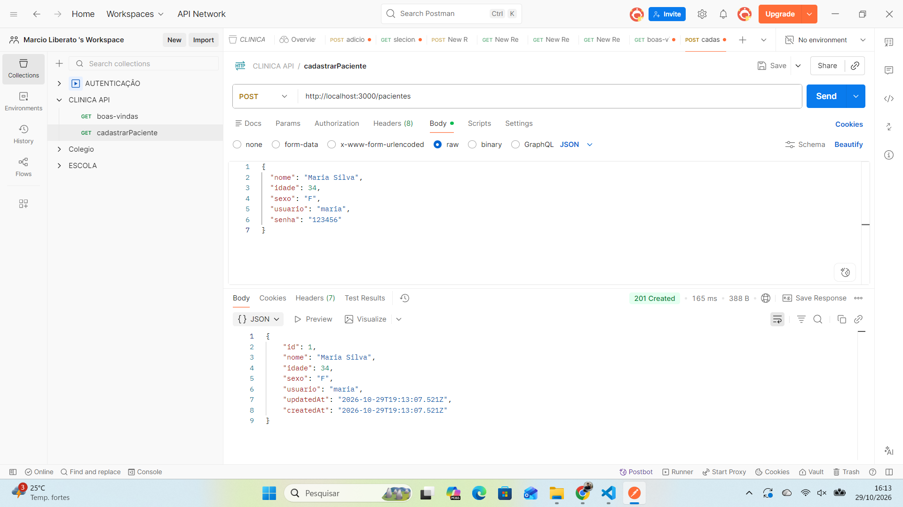
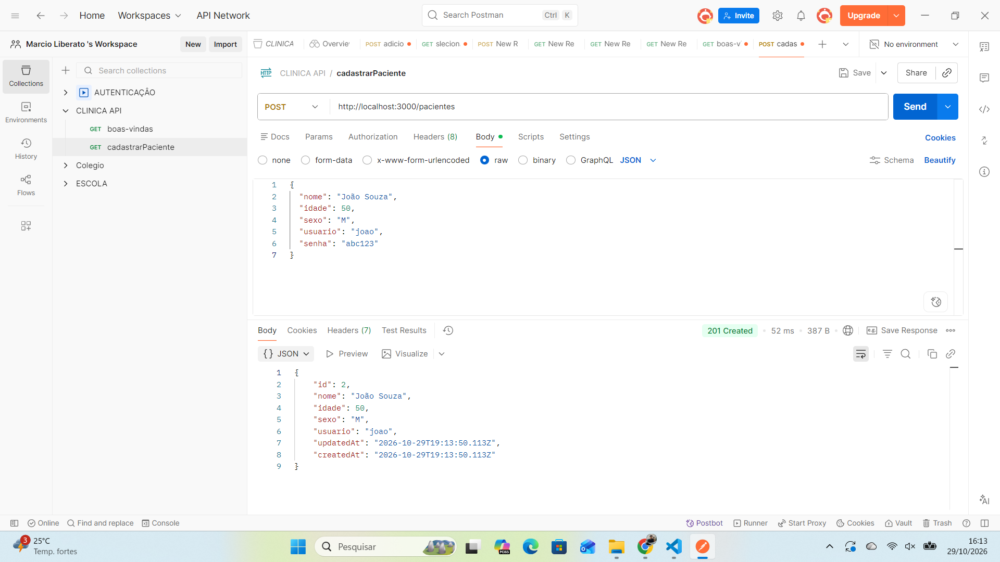
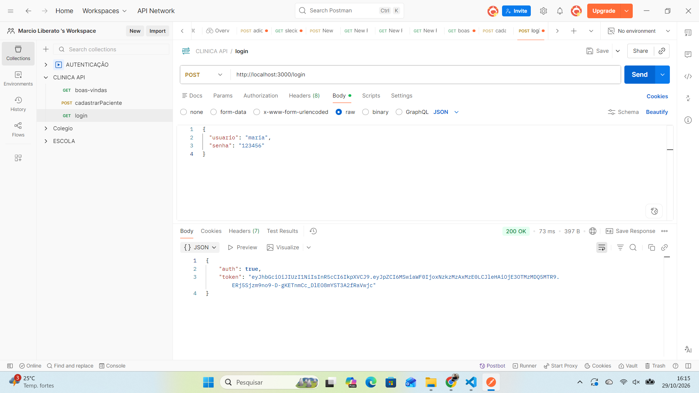
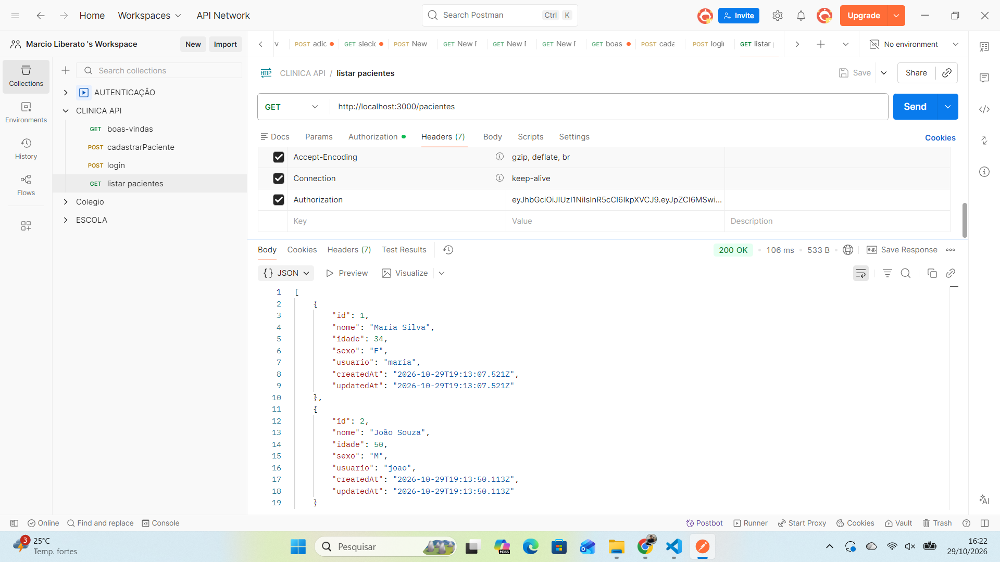
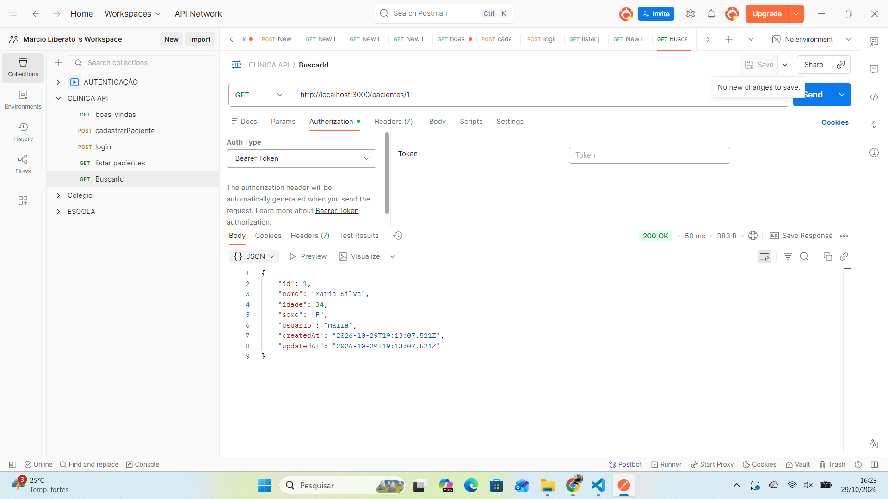
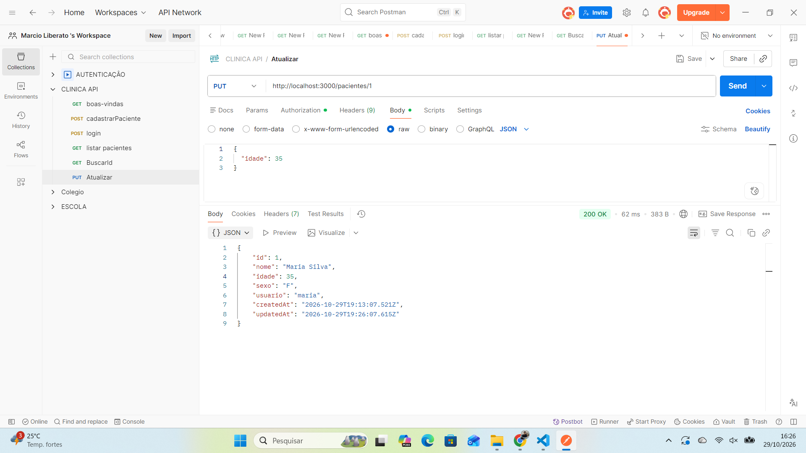
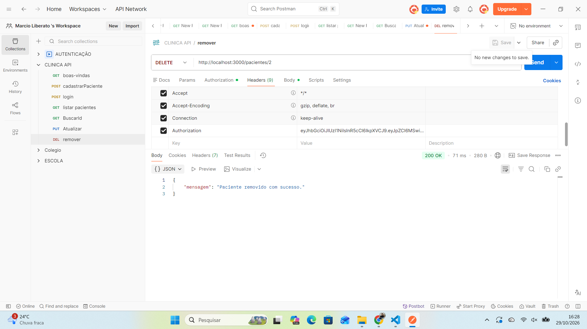
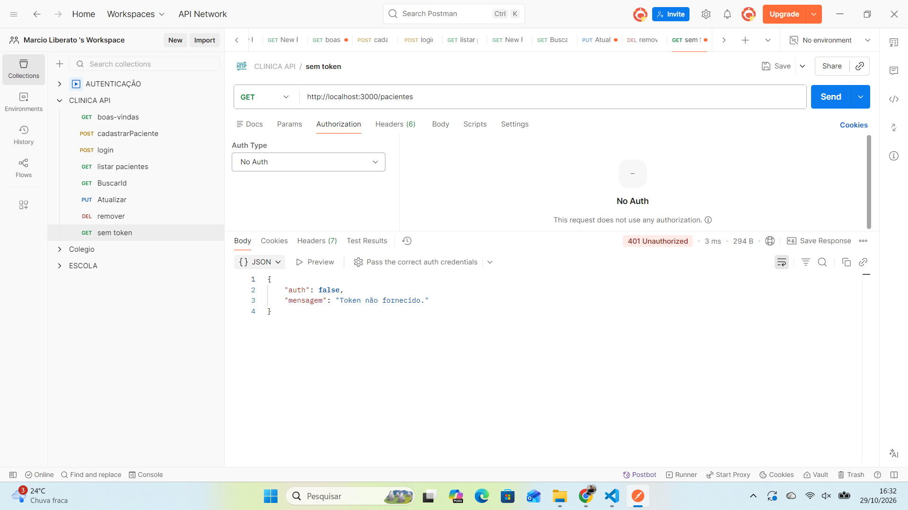

# API Clínica Médica

API RESTful para gestão de pacientes de uma clínica médica, com cadastro, login e CRUD completo. As rotas privadas são protegidas por autenticação JWT.

## Tecnologias

- **Node.js** + **Express 5**
- **PostgreSQL** com **Sequelize** (ORM, models e migrations)
- **JSON Web Token (JWT)** para autenticação
- **dotenv** para variáveis de ambiente
- **Postman** para testes dos endpoints

## Estrutura

```
clinica-api/
├── app.js                  # Ponto de entrada da aplicação
├── config/config.js        # Configuração do banco (lê o .env)
├── middlewares/
│   └── verificaJWT.js      # Valida o token nas rotas privadas
├── migrations/             # Criação da tabela Pacientes
├── models/                 # Model Paciente (Sequelize)
├── routes/
│   ├── auth.js             # POST /login
│   └── pacientes.js        # CRUD de pacientes
└── prints/                 # Testes feitos no Postman
```

## Como rodar

**Pré-requisitos:** Node.js e PostgreSQL instalados.

1. Clone o repositório e instale as dependências:

   ```bash
   git clone https://github.com/mvictorliberato-maker/clinica-api.git
   cd clinica-api
   npm install
   ```

2. Copie o arquivo `.env.example` para `.env` e preencha com os dados do seu banco e um segredo para o JWT.

3. Crie o banco e rode as migrations:

   ```bash
   npx sequelize-cli db:create
   npx sequelize-cli db:migrate
   ```

4. Inicie a API:

   ```bash
   npm run dev    # com nodemon
   npm start      # sem nodemon
   ```

   A API sobe em `http://localhost:3000`.

## Rotas

| Método | Rota | Acesso | Descrição |
| --- | --- | --- | --- |
| GET | `/` | Pública | Mensagem de boas-vindas |
| POST | `/pacientes` | Pública | Cadastra um paciente |
| POST | `/login` | Pública | Autentica e retorna o token JWT |
| GET | `/pacientes` | Privada | Lista todos os pacientes |
| GET | `/pacientes/:id` | Privada | Busca um paciente pelo id |
| PUT | `/pacientes/:id` | Privada | Atualiza os dados de um paciente |
| DELETE | `/pacientes/:id` | Privada | Remove um paciente |

Nas rotas privadas, envie o token no cabeçalho:

```
Authorization: Bearer <seu_token>
```

### Exemplo de cadastro

`POST /pacientes`

```json
{
  "nome": "Maria Silva",
  "idade": 30,
  "sexo": "F",
  "usuario": "maria",
  "senha": "123456"
}
```

### Exemplo de login

`POST /login`

```json
{
  "usuario": "maria",
  "senha": "123456"
}
```

Resposta:

```json
{
  "auth": true,
  "token": "eyJhbGciOiJIUzI1NiIs..."
}
```

A senha nunca é devolvida nas respostas da API.

## Testes no Postman

| Teste | Print |
| --- | --- |
| Boas-vindas |  |
| Cadastro (Maria) |  |
| Cadastro (João) |  |
| Login |  |
| Listar pacientes |  |
| Buscar por id |  |
| Atualizar |  |
| Remover |  |
| Acesso sem token (401) |  |

## Próximos passos

- Criptografar as senhas com bcrypt
- Adicionar entidades de médicos e consultas
- Escrever testes automatizados com Jest

## Autor

**Márcio Liberato** · [LinkedIn](https://www.linkedin.com/in/marcio-liberato) · [GitHub](https://github.com/mvictorliberato-maker)
